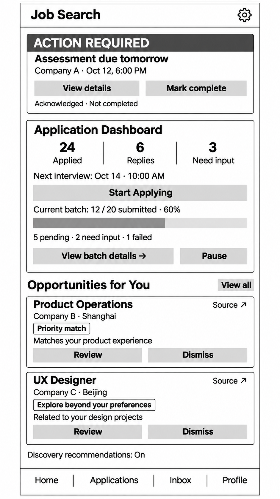

# Final Project Proposal: AI Job Application Assistant

Source: [Notion proposal](https://app.notion.com/p/416a0e5b1afc801b9a92cd9b1ff014b6?pvs=204).

## Idea

For my final project, I want to make an iOS app that helps people keep track of their job applications and prepare for interviews.

After applying for several jobs, it can be difficult to remember which companies have replied, which messages need an answer, and when the next deadline is. Information is often spread across email, recruiting websites, and personal notes.

My idea is to connect these pieces in one place. With permission to access the user's email, the app would automatically read job-related messages, update application records, and bring upcoming tasks to their attention. It would also keep their experience and preparation materials available on their phone.

I want the mobile experience to make it easy to check progress during the day, respond to something that needs attention, or review notes before an interview.

*Earlier dashboard concept. The planned version keeps the overview and focuses on application updates and preparation. Automatic submission and batch-progress controls shown in this earlier design are outside the initial prototype.*

## What I want to build

### Email updates

After the user connects their email, the app would check for new messages in the background. AI would identify messages related to job applications and extract the company, role, application update, required action, and any relevant dates.

For example, an assessment invitation could update the application stage and create a task with a deadline. The user would not have to copy each email into the app or sort messages themselves. If the company, deadline, or meaning is unclear, the app would ask them to check.

Each summary would include a **View Original Email** link so the user can return to the full message.

### Application records

Each application would have its own record, bringing together its current stage, past updates, related messages, tasks, and preparation materials. If there is no new information, the app would keep the last known status.

Users could also add applications manually. This matters because an interview invitation might arrive by phone or through a recruiting website's chat, and some applications never generate a confirmation email. The form would include the company, role, stage, source, dates, notes, links, and attachments.

Manually added tasks would use the same reminder and completion rules as tasks created from email. If a related email arrives later, the app would try to connect it to the existing record.

### Home dashboard

I want to keep the Application Dashboard from my earlier design as the main overview. Urgent tasks would appear above it, with recent updates below.

The dashboard would show:

- Applications submitted.
- Responses received.
- Unfinished tasks.
- Items waiting for the user's input or confirmation.
- The next confirmed interview.
- Applications grouped by their current stage.

Tapping a number would open the relevant list. Individual applications would have a timeline of updates. Progress would be shown through stages and counts rather than a percentage that suggests the hiring process has a predictable endpoint.

### Messages and reminders

I want the app to distinguish between messages that simply update a record, messages worth reading closely, and tasks that need action before a deadline.

| Message or task | What the app would do |
| --- | --- |
| Routine confirmations, such as “We received your application” | Update the record without repeatedly interrupting the user |
| Recruiter replies about the user's experience, questions about their skills, or interview invitations | Highlight the actual response and make it easy to read or answer |
| Interview scheduling, assessments, document requests, or other actions with deadlines | Show the required action and deadline, move the task up as the deadline approaches, and send reminders |
| Rejection emails | Mark the application as rejected and send one standard notification, helping the user know they can stop waiting |
| Messages with unclear importance, timing, or instructions | Show what needs checking and link to the original message |

A recruiter reply would not automatically be treated as urgent. The need to act and the time remaining would determine how strongly it is emphasized.

Each task would explain what to do, when it is due, and why it appears near the top. Tapping a phone notification would open that task, with a link back to its source.

**Acknowledged and Completed would be separate states.** Reading a reminder, dismissing a notification, or tapping Acknowledged would not complete the task. Unfinished tasks would stay visible on the home screen and remain included in the dashboard count.

For a deadline-based task that has not been acknowledged, the app would send another reminder one day before the deadline. It would check the current completion status before sending follow-up reminders. Rejections would not become pinned tasks or trigger repeated reminders.

### A personal experience library

Users could build a collection of their resume, education, work experience, projects, skills, and interview examples. They could add material by:

- Typing an experience or adding details to an existing one.
- Speaking about an experience and reviewing the transcription.
- Importing documents such as PDF, Word, Markdown, TXT, or Pages files.

For voice input, I imagine the user describing a project naturally, then seeing an editable transcript and an AI-organized entry covering the background, their role, actions, and results. File compatibility would be tested with sample documents, with a conversion option where needed.

Users could review extracted information, keep the original source, and edit or delete entries. Missing details would be marked for them to fill in.

### Interview preparation

Each application would have a preparation space containing the job description, submitted materials, interview details, and notes.

Users could enter questions they think they might be asked. AI would find relevant experiences in their library and use them, together with the job description, to draft an answer. Users could change the language, length, and tone, edit the result, and save it for later.

The answer would show which experiences it used. If the library does not contain enough information, it would ask for details rather than invent responsibilities or results. Generated drafts would stay separate from confirmed personal information unless the user chooses to add them.

## Main screens

| Screen | What happens there |
| --- | --- |
| Home | See urgent tasks, the dashboard, and recent updates |
| Applications | Search and filter applications, or add one manually |
| Application Details | View the current stage, timeline, messages, tasks, and preparation links |
| Task Details | Check the action, deadline, and source; mark Acknowledged or Completed |
| My Experience Library | Add, review, edit, or delete material using text, voice, or files |
| Interview Preparation | Review materials, enter questions, generate answers, and save notes |
| Settings | Connect or disconnect email, pause checking, and change notification preferences |

## How I plan to build it

These are the main technologies I am considering. I will adjust the details as I test the prototype.

| Technology | What I would use it for |
| --- | --- |
| Swift and SwiftUI | Build the dashboard, lists, navigation, forms, and notes, with shared state keeping the screens up to date |
| OAuth 2.0 and Gmail API | Let users authorize email access and read messages and conversations; I plan to start with Gmail |
| Firebase Cloud Functions | Check email, call AI, update records, and check reminder conditions while the phone app is closed |
| An AI API, such as OpenAI Responses API | Analyze emails, return structured information, organize experience entries, and draft interview answers through HTTPS requests; keep the API key on the server |
| Firebase Authentication, Firestore, and Storage | Manage accounts and store each user's application records, tasks, experience entries, and files |
| Firebase Cloud Messaging, APNs, and UserNotifications | Deliver phone notifications and open the corresponding task when tapped |
| Apple's Speech framework | Turn spoken experiences into editable text |
| SwiftUI file import and document parsing | Import files and extract their contents, using visual recognition when needed |
| Retrieval from the experience library | Find relevant material and include it with the interview question and job information in the AI request |

For the first version, I plan to test the email-to-reminder flow with authorized test accounts. Email checking would run on the server so it does not depend on the iOS app staying open.

## Focus for the final project

I want to focus on what happens after someone applies: keeping track of responses, making deadlines easier to handle, and having useful preparation material close at hand. Searching career websites and automatically submitting applications could be later additions.

Users would be able to correct the app's interpretation, pause email checking, disconnect their account, and control notifications. Decisions such as replying to a recruiter or booking an interview would stay with the user.

This project builds on my earlier [Job Application Automation Proposal](https://app.notion.com/p/410a0e5b1afc80c8bb9dd6030a9633c8), with the focus moved toward the parts I think are most useful on a phone.

## Week-by-week work plan

- **Week 10:** Decide on the idea and write the proposal.
- **Week 11:** Build the main screens and add manual application records.
- **Week 12:** Connect the database and test AI with job emails.
- **Between Weeks 12 and 13:** Connect Gmail and add task reminders.
- **Week 13:** Add the experience library and interview answers, then test the app.
- **Week 14:** Fix bugs and prepare the final presentation.
